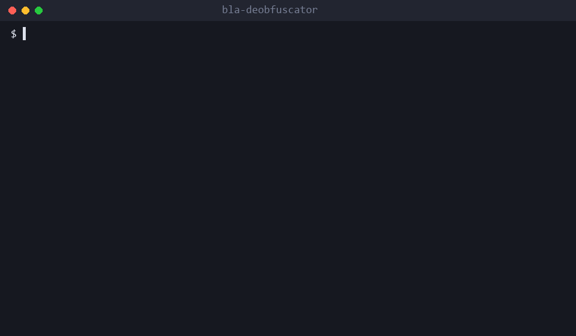

<div align="center">

# bla-deobfuscator

**Static deobfuscator for JavaScript hardened with [BLA](https://github.com/qybaihe/bla) (`bla-agents`).**

Removes decoys, canaries and integrity scaffolding, decrypts string tables, folds opaque predicates
and renames what is left to readable names, without ever running the input.

[](https://github.com/unnxor/bla-deobfuscator/actions/workflows/ci.yml)
[](https://www.npmjs.com/package/bla-deobfuscator)

-blue)


</div>

<p align="center"></p>

---

## Quick start

```bash
npx bla-deobfuscator protected.js clean.js
```

Or install it globally: `npm install -g bla-deobfuscator`, then `bla-deobfuscator protected.js clean.js`.

From source:

```bash
git clone https://github.com/unnxor/bla-deobfuscator && cd bla-deobfuscator
npm install
node src/cli.js protected.js clean.js
```

One input, one output. No flags, no config, no side files. Missing output directories are created, the input is
never modified.

## Example

A 12-line module protected with BLA 3.3.2 (`maximum`, self-seal + weave decoys):

| | Size | Lines |
|---|---|---|
| Original | 293 B | 12 |
| BLA output | 122 467 B | 2 312 |
| **After bla-deobfuscator** | **246 B** | **12** |

Exports and parameter names survive BLA, so this example comes back almost identical. Names of local variables do not
(`price` and `percent` came back as `num` and `num2`).

Original and cleaned output return identical results (checked on the real libraries below and by `npm test`).
**Full results for all 36 runs (every library in every BLA mode) are in [`results/RESULTS.md`](results/RESULTS.md).**

### Tested on real libraries

Each file was protected with `bla-agents` 3.3.2 (`--intensity maximum`, fixed seed), cleaned with this tool, and the
cleaned module was called with the same inputs as the original. Results were identical in every case.

| Library | Original | After BLA | After bla-deobfuscator | Time |
|---|---|---|---|---|
| `is-number` | 411 B | 117 226 B | 260 B | <1 s |
| `escape-html` | 1 362 B | 125 326 B | 821 B | <1 s |
| `fast-deep-equal` | 1 177 B | 119 219 B | 1 145 B | <1 s |
| `bytes` | 3 613 B | 126 792 B | 2 071 B | <1 s |
| `ms` | 3 024 B | 175 359 B | 2 431 B | <1 s |
| `camelcase` | 3 272 B | 125 436 B | 2 555 B | <1 s |
| `dayjs.min.js` (minified UMD) | 7 160 B | 242 775 B | 15 400 B | ~1 s |
| `acorn` | 233 938 B | 1 732 467 B | 195 226 B | ~12 s |

The full report also covers the BLA modes `stealth`, `balanced`, `bankrupt` and `--self-seal --weave-decoys`. In the lighter modes (`stealth`, `balanced`) BLA adds
less scaffolding and the cleaned file can end up larger than the original, because the tool pretty-prints the code
(for example `camelcase` 3 272 B -> 5 066 B in `balanced`). Minified input stays larger after cleaning for the same reason.

## What it does

| Step | Handles |
|---|---|
| Strip | Comments, source-map links, LLM-directed canary text |
| Seed analysis | Recovers the known bits of BLA's opaque seed from the armor digest |
| Fold | Opaque predicates, constant and MBA-style expressions, ternary chains |
| Unweave | Shadow-heap stepper calls, `void x;` anchors, deception IIFEs |
| Strings | Decrypts XOR string tables and inlines the plain strings |
| Dead code | Decoy and labyrinth functions, state objects, chaff, unused `node:` imports, integrity measures |
| Rename | `num12341`, `_0x1a2b`, `verbAdjNoun_1f8` and other generated names become readable names inferred from usage |

Tested on CommonJS modules and UMD bundles, in strict and sloppy mode. ES modules and plain browser globals are handled by the code but are not covered by the test suite. Directive prologues and the
module type are preserved.

## Safety by design

- **The input is never executed.** String decoders and the armor digest are evaluated by a small built-in AST
  interpreter with a whitelist of node types, globals and native functions, a step budget and banned property
  names. There is no `vm`, no `eval`, no `new Function`.
- **No regular expressions.** All matching is done on the Babel AST or with plain string and character logic.
- **Fail-safe pipeline.** Every pass is validated (output must re-parse, keep the module type, exports, directives
  and free globals) and is rolled back if it fails. Invalid input is copied through unchanged. The run is limited
  to 120 seconds, then the last good result is written.
- **Deterministic.** Same input, same output. Running the tool on its own output changes nothing.

## Limitations

- **JavaScript only.** WASM, native code, Python, DEX, ASAR and other BLA targets are not touched.
- **Original names are gone.** BLA destroys them. Names are only recovered from what survives, such as export keys
  and `require()` targets. Everything else gets a descriptive guess (`parts`, `text`, `fn`), which can be wrong.
- **Secrets outside the file stay secret.** Keys or seeds bound to sidecar files or runtime state cannot be
  recovered statically.
- **Integrity checks are removed.** The result is meant for reading and analysis, not as a drop-in replacement for
  the protected build.
- **Tested against `bla-agents` 3.3.2** output. Other versions may use shapes that are not recognised. Anything
  unproven is left untouched rather than guessed.

## Requirements

Node.js 14.18 or newer. Runtime dependencies: `@babel/parser`, `@babel/traverse`, `@babel/generator`, `@babel/types`
(pinned).

## Tests

`npm test` (31 tests, about a minute; saved output in [`results/test-output.txt`](results/test-output.txt)). `npm run results` regenerates the whole [`results/`](results) folder. It checks the CLI, cleans two real `bla-agents` 3.3.2 outputs (`test/fixtures`) against
expected files, and runs a differential test on 8 real libraries in 3 BLA modes. The library tests need Node 22.23+ because `bla-agents` does.

## Responsible use

Use it on code you own, on software you are authorised to analyse, or for research and education. BLA is a
defensive tool; this project is an independent study of its output and is not affiliated with it.
